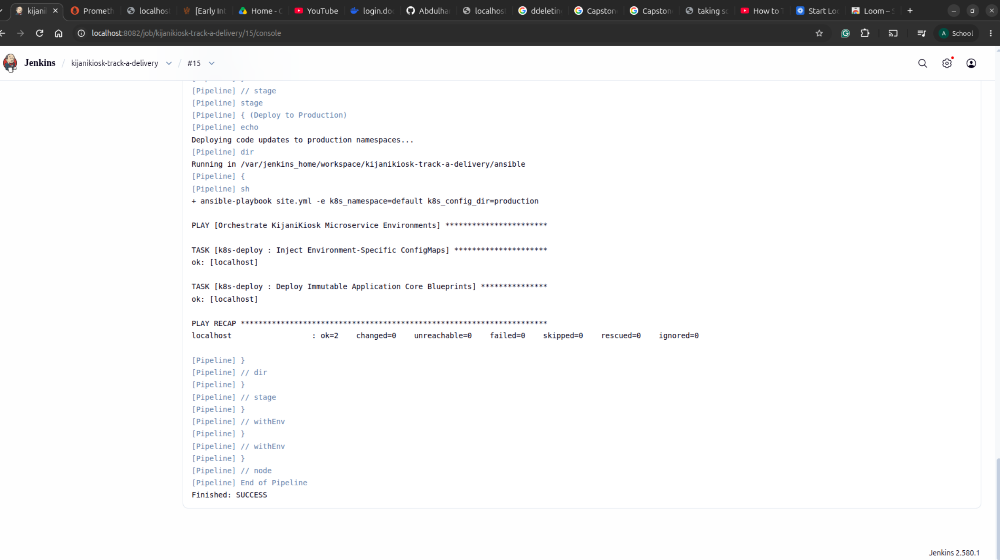
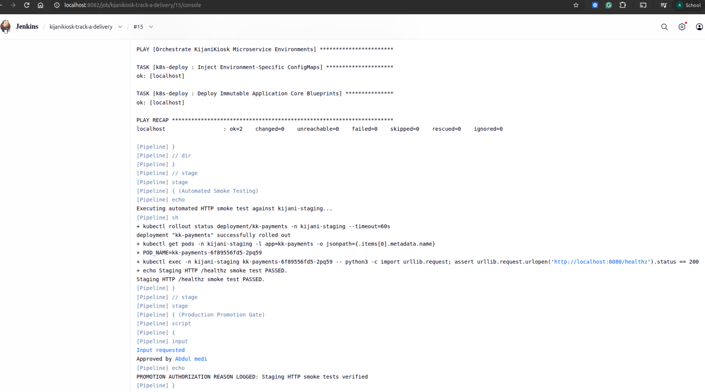
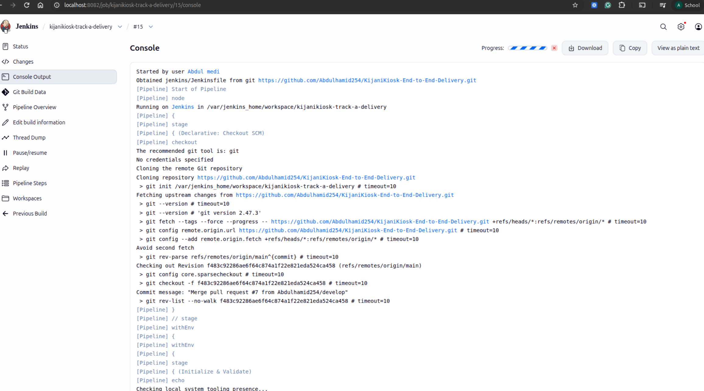
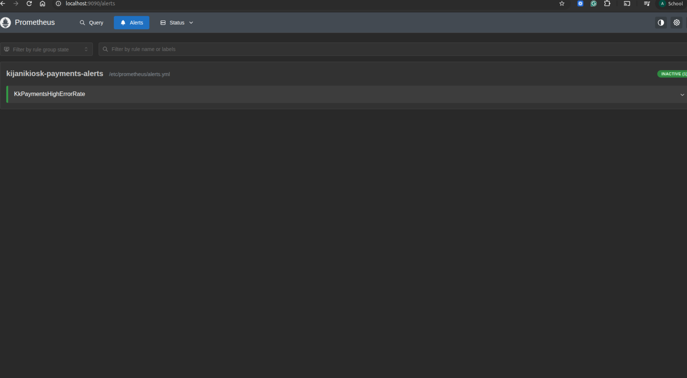

# CI/CD Pipeline Execution & Fault-Handling Evidence (CAP-2)

* **LSCREENSHOT  VERIFICATION** `SCREENSHOTS TO PROVE THIS`

   

***FLIPPING KkPaymentsHighErrorRate FROM INACTIVE -> PENDING -> FIRING- SENDING BASELINE TRAFFIC PLUS FAULT INJECTION**
 

* **Pipeline Job:** `kijanikiosk-track-a-delivery` (`jenkins/Jenkinsfile`)
* **Target Environments:** `kijani-staging` (automated) -> `default` (gated production)

## Verified Pipeline Stages
1. **Initialize & Validate:** Verified `terraform`, `ansible`, and `kubectl` binaries.
2. **Infrastructure Provision:** Applied Terraform state managing isolated `kijani-staging` and `default` namespaces.
3. **Deploy to Staging Namespace:** Executed Ansible playbook injecting staging `ConfigMap` (`DB_HOST=stg-db-service`, `RECEIPT_BUCKET=kk-payments-receipts-staging`) and shared `Deployment`.
4. **Automated Smoke Testing:** Verified `kk-payments` pods reached `Running` and passed `/healthz` checks in `kijani-staging`.
5. **Production Promotion Gate:** Blocked automated promotion until operator submitted `APPROVE_REASON` justification, logged to Jenkins console output.
6. **Deploy to Production:** Promoted verified image to `default` namespace with production `ConfigMap`.
